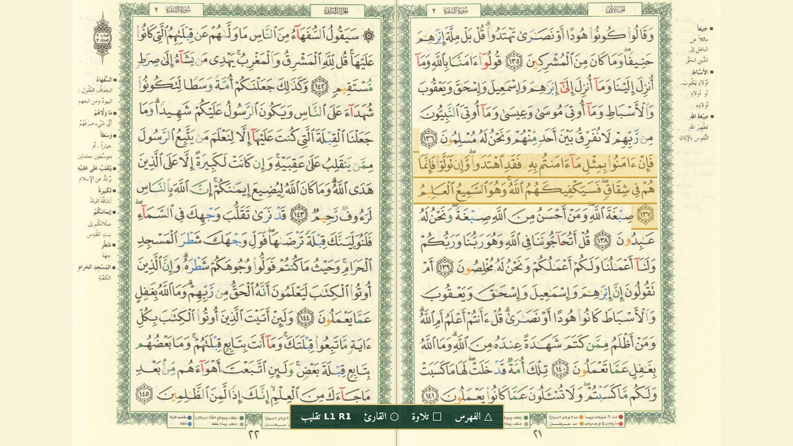

# Quran PS5 — القرآن الكريم

تطبيق مصحف المدينة لأجهزة PS5 المعدّلة (homebrew)، يعمل كتطبيق أصلي (native title) برقم `QRAN00001`.

## المزايا

- **المصحف كاملًا (604 صفحات):** يعرض صفحتين متجاورتين بملء الشاشة، والصفحة الفردية على اليمين. الصفحات تُنزَّل من الإنترنت وتُحفظ في الجهاز.
- **الفهرس (△):** السور الـ114 والأجزاء الثلاثون، مع صفحة بداية كل منها.
- **التلاوة (□):** آية بآية من everyayah.com، تبدأ من أول آية في الصفحة الظاهرة. البسملة تُضاف قبل كل سورة، والصفحات تتقلب تلقائيًا، وكل آية تُحفظ في الجهاز بعد سماعها.
- **تمييز الآية:** الآية التي تُتلى تظهر بخلفية ذهبية على الصفحة.
- **ثمانية قرّاء (○):** العفاسي، الحصري، المنشاوي، عبد الباسط، السديس، الشريم، الشاطري، هاني الرفاعي.
- **حفظ الحالة:** التطبيق يتذكر آخر صفحة قرأتها والقارئ الذي اخترته.

## التحكم

| الزر | الوظيفة |
|---|---|
| L1 / ◀ | الصفحة التالية |
| R1 / ▶ | الصفحة السابقة |
| ▲ ▼ | قفز 20 صفحة |
| △ | الفهرس |
| □ | تشغيل التلاوة / إيقاف مؤقت |
| ○ | اختيار القارئ |
| ✕ | إعادة تنزيل الصفحات التي فشل تنزيلها |
| Options / لوحة اللمس | شرح الأزرار |

## التثبيت

1. انسخ المجلد `QRAN00001` إلى `/data/homebrew/QRAN00001`.
2. شغّل الـ jailbreak وkstuff وShadowMount+، ثم افحص الألعاب (Scan).
3. افتح **Quran - القرآن الكريم**. يحتاج التطبيق اتصالًا بالإنترنت لتنزيل الصفحات والتلاوة.

جُرّب على PS5 بنظام 13.60.

## التطوير

طريقة البناء على Linux وعلى PS5 في الملف [BUILD.md](BUILD.md).

## المصادر والرخص

المصادر والرخص في [NOTICE.md](NOTICE.md).

تطبيق PS5 من تطوير **Youss Riaal**.
